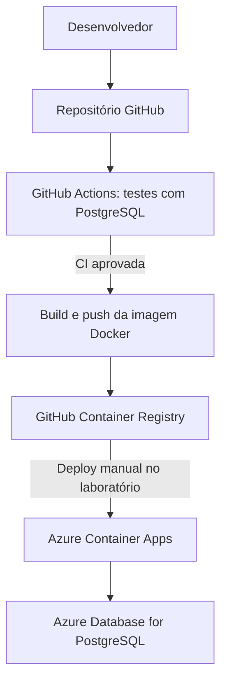

# TaskFlow API

API REST de gerenciamento de tarefas desenvolvida para estudo de **Java, Spring Boot, PostgreSQL, Docker, CI/CD e Microsoft Azure**.

**Projeto acadêmico — FIAP**  
**Marcus Vinicius de Souza Calazans — RM 556620**

## Visão geral

O TaskFlow permite cadastrar, listar, consultar, atualizar e excluir tarefas, persistindo os dados em PostgreSQL. O projeto foi executado localmente com Docker Compose e publicado no **Azure Container Apps**, conectado ao **Azure Database for PostgreSQL Flexible Server**.

### Tecnologias

- Java 21 e Spring Boot 4.1.2
- Spring Web, Spring Data JPA, Bean Validation e Actuator
- PostgreSQL 16
- Maven Wrapper, JUnit e Mockito
- Docker e Docker Compose
- GitHub Actions (CI e publicação de imagem)
- GitHub Container Registry (GHCR)
- Azure Container Apps e Azure Database for PostgreSQL

## Arquitetura



> **Importante:** a execução dos testes e a publicação da imagem no GHCR estão automatizadas. O **deploy no Azure foi realizado manualmente**; ainda não há um fluxo de implantação contínua automatizado para Azure.

## Funcionalidades e API REST

| Método | Endpoint | Função |
|---|---|---|
| `GET` | `/actuator/health` | Verificar a saúde da aplicação |
| `GET` | `/api/tarefas` | Listar tarefas |
| `GET` | `/api/tarefas/{id}` | Consultar tarefa por ID |
| `POST` | `/api/tarefas` | Cadastrar tarefa |
| `PUT` | `/api/tarefas/{id}` | Atualizar tarefa |
| `DELETE` | `/api/tarefas/{id}` | Excluir tarefa |

Exemplo de requisição `POST /api/tarefas`:

```json
{
  "titulo": "Estudar DevOps",
  "descricao": "Praticar GitHub Actions e Docker",
  "status": "PENDENTE"
}
```

Status aceitos: `PENDENTE`, `EM_ANDAMENTO` e `CONCLUIDA`.

## Estrutura do projeto

```text
src/
  main/
    java/br/com/fiap/taskflow/
      controller/TaskController.java
      dto/TarefaRequest.java
      exception/ApiExceptionHandler.java
      model/Tarefa.java
      model/StatusTarefa.java
      repository/TarefaRepository.java
      service/TaskService.java
      TaskflowApplication.java
    resources/application.properties
  test/java/br/com/fiap/taskflow/
    service/TaskServiceTest.java
    TaskflowApplicationTests.java
Dockerfile
compose.yaml
.dockerignore
.env.example
.github/workflows/ci.yml
.github/workflows/docker-publish.yml
pom.xml
```

## Requisitos

- JDK 21
- Docker Desktop com Docker Compose
- PowerShell (comandos abaixo); os equivalentes Linux/macOS também são possíveis
- Git
- Azure CLI somente para etapas de nuvem
- Conta GitHub e, para a nuvem, assinatura Azure com permissões adequadas

## 1. Executar localmente com Docker

Crie um arquivo `.env` baseado no `.env.example` na raiz do repositório:

```dotenv
DB_NAME=taskflow
DB_USER=taskflow
DB_PASSWORD=defina_uma_senha_local
```

Use uma senha exclusiva de desenvolvimento. **Nunca envie `.env`, senhas ou tokens para o Git.**

```powershell
docker compose config --quiet
docker compose up -d --build
docker compose ps
```

O Compose disponibiliza:

- API em `http://localhost:8081`
- PostgreSQL na porta local `5433`
- Conexão interna da API com o serviço Docker `db:5432`

Teste:

```powershell
Invoke-RestMethod http://localhost:8081/actuator/health
Invoke-RestMethod http://localhost:8081/api/tarefas
```

Logs e encerramento:

```powershell
docker compose logs api --tail 50
docker compose down
```

`docker compose down` **não remove o volume persistente** por padrão. Evite `docker compose down -v` se precisar conservar os dados.

### Maven e testes

Os testes de integração precisam de um PostgreSQL acessível. Com o serviço `db` do Compose iniciado, o Maven executado no Windows acessa o banco pela porta `5433`.

```powershell
docker compose up -d db
$env:DB_PASSWORD = "SENHA_CONFIGURADA_NO_ENV"
.\mvnw.cmd clean test
.\mvnw.cmd clean package
Remove-Item Env:DB_PASSWORD
```

No laboratório foram validados **4 testes automatizados**: três testes de serviço com Mockito e um teste de contexto Spring Boot.

## 2. Git e GitHub

Para publicar um repositório novo (crie-o vazio no GitHub antes):

```powershell
git init
git branch -M main
git add .
git diff --cached --check
git status --short
git commit -m "feat: implementa TaskFlow API"
git remote add origin https://github.com/calazans-999/taskflow-api.git
git push -u origin main
```

Para atualizações seguintes:

```powershell
git add .
git commit -m "docs: atualiza documentacao"
git push origin main
```

## 3. CI/CD com GitHub Actions

- `.github/workflows/ci.yml`: executa a integração contínua, preparando Java 21, PostgreSQL temporário e testes Maven.
- `.github/workflows/docker-publish.yml`: após a aprovação da CI na `main`, constrói e publica a imagem no GHCR.

A imagem publicada neste laboratório foi:

```text
ghcr.io/calazans-999/taskflow-api:830c553c34bd83eeae2f611ea2f139f0d1b4aca4
```

O pacote do laboratório é **privado**. Para baixá-lo localmente, utilize um token GitHub **Classic** com a permissão `read:packages`, sem expor seu conteúdo:

```powershell
$tokenSeguro = Read-Host "Token GitHub" -AsSecureString
$token = [System.Net.NetworkCredential]::new("", $tokenSeguro).Password
$token | docker login ghcr.io -u calazans-999 --password-stdin
Remove-Variable token, tokenSeguro

docker pull ghcr.io/calazans-999/taskflow-api:830c553c34bd83eeae2f611ea2f139f0d1b4aca4
```

## 4. Azure — Provisionamento de laboratório

> **Atenção a custos e segurança:** os comandos desta seção **criam recursos que podem gerar cobrança**. Eles documentam o laboratório realizado, não uma configuração recomendada para produção. A política regional da assinatura utilizada permitia `francecentral`, entre outras regiões; confira as políticas da sua própria assinatura antes de executar.

### Login, provedores e grupo de recursos

```powershell
az login
az account show --output table
az policy assignment list --query "[].{Nome:displayName,Parametros:parameters}" --output json

az provider register --namespace Microsoft.App --wait
az provider register --namespace Microsoft.DBforPostgreSQL --wait
az provider register --namespace Microsoft.OperationalInsights --wait

az group create --name rg-taskflow-fiap --location francecentral --output table
```

### PostgreSQL Flexible Server

Crie uma senha forte e guarde-a em um gerenciador de senhas:

```powershell
$dbSeguro = Read-Host "Senha do PostgreSQL Azure" -AsSecureString
$dbSenha = [System.Net.NetworkCredential]::new("", $dbSeguro).Password

az postgres flexible-server create `
  --resource-group rg-taskflow-fiap `
  --name pg-taskflow-fiap-556620 `
  --location francecentral `
  --admin-user taskflowadmin `
  --admin-password $dbSenha `
  --version 16 `
  --tier Burstable `
  --sku-name Standard_B1ms `
  --storage-size 32 `
  --public-access None `
  --backup-retention 7 `
  --storage-auto-grow Disabled `
  --output none

az postgres flexible-server db create `
  --resource-group rg-taskflow-fiap `
  --server-name pg-taskflow-fiap-556620 `
  --database-name taskflow
```

O nome do servidor deve ser globalmente único. Se ele já existir ou estiver indisponível, escolha outro e atualize as referências correspondentes.

### Acesso de rede utilizado no laboratório

O banco foi criado sem acesso público inicialmente. Para a implantação temporária com Container Apps sem rede virtual dedicada, foi habilitado o acesso público e criada uma regra permitindo origens de serviços Azure:

```powershell
az postgres flexible-server update `
  --resource-group rg-taskflow-fiap `
  --name pg-taskflow-fiap-556620 `
  --public-access Enabled `
  --output none

az postgres flexible-server firewall-rule create `
  --resource-group rg-taskflow-fiap `
  --name pg-taskflow-fiap-556620 `
  --rule-name permitir-azure-laboratorio `
  --start-ip-address 0.0.0.0 `
  --end-ip-address 0.0.0.0
```

**Risco:** a regra `0.0.0.0` neste serviço permite tentativas de conexão originadas de serviços Azure **de outras assinaturas**. Use somente em laboratório temporário, com credenciais fortes. Para produção, prefira rede privada e controles de acesso restritos.

Para testar a conectividade do seu computador, libere temporariamente apenas seu IPv4 público:

```powershell
$meuIP = (Invoke-RestMethod "https://api.ipify.org").Trim()

az postgres flexible-server firewall-rule create `
  --resource-group rg-taskflow-fiap `
  --name pg-taskflow-fiap-556620 `
  --rule-name permitir-meu-pc `
  --start-ip-address $meuIP `
  --end-ip-address $meuIP

Test-NetConnection pg-taskflow-fiap-556620.postgres.database.azure.com -Port 5432
```

`TcpTestSucceeded: True` confirma apenas conectividade TCP; a autenticação no PostgreSQL também deve ser testada.

### Ambiente Azure Container Apps

```powershell
az extension add --name containerapp --upgrade

az containerapp env create `
  --name env-taskflow-fiap `
  --resource-group rg-taskflow-fiap `
  --location francecentral `
  --logs-destination none `
  --output table
```

### Implantar a API

O token do GitHub deve ter `read:packages` e conseguir autenticar no GHCR. Informe o valor **da variável** no parâmetro `--registry-password` (não a string literal `secretref:...` nesse comando de criação):

```powershell
$ghSeguro = Read-Host "Token Classic do GitHub (read:packages)" -AsSecureString
$ghToken = [System.Net.NetworkCredential]::new("", $ghSeguro).Password

# Se a senha do banco não estiver na sessão, recupere-a com Read-Host também.

az containerapp create `
  --name taskflow-api `
  --resource-group rg-taskflow-fiap `
  --environment env-taskflow-fiap `
  --image ghcr.io/calazans-999/taskflow-api:830c553c34bd83eeae2f611ea2f139f0d1b4aca4 `
  --registry-server ghcr.io `
  --registry-username calazans-999 `
  --registry-password $ghToken `
  --secrets "db-password=$dbSenha" `
  --env-vars `
    "SPRING_DATASOURCE_URL=jdbc:postgresql://pg-taskflow-fiap-556620.postgres.database.azure.com:5432/taskflow?sslmode=require" `
    "SPRING_DATASOURCE_USERNAME=taskflowadmin" `
    "SPRING_DATASOURCE_PASSWORD=secretref:db-password" `
    "SPRING_JPA_OPEN_IN_VIEW=false" `
  --ingress external `
  --target-port 8080 `
  --cpu 0.5 `
  --memory 1.0Gi `
  --min-replicas 0 `
  --max-replicas 1 `
  --output none
```

**Observações:** a senha do banco e o token são passados ao processo Azure CLI e podem ficar temporariamente visíveis a processos locais. Em produção, adote gestão de segredos com identidade gerenciada e serviços apropriados. A API do laboratório **não possui autenticação própria**, portanto não deve receber dados reais ou sensíveis enquanto exposta publicamente.

Validação:

```powershell
az containerapp show `
  --name taskflow-api `
  --resource-group rg-taskflow-fiap `
  --query "{Nome:name,Estado:properties.provisioningState,URL:properties.configuration.ingress.fqdn}" `
  --output table

az containerapp revision list `
  --name taskflow-api `
  --resource-group rg-taskflow-fiap `
  --query "[].{Nome:name,Estado:properties.provisioningState,Saude:properties.healthState,Execucao:properties.runningState}" `
  --output table
```

> Em ambientes Container Apps **Express**, o parâmetro `--revision-suffix` pode não ser suportado. O ambiente do laboratório foi criado nessa modalidade.

## 5. Verificação do CRUD via HTTPS

O endereço abaixo foi utilizado durante o laboratório; pode deixar de funcionar após a exclusão da infraestrutura.

```powershell
$url = "https://taskflow-api.whitehill-a93fa94a.francecentral.azurecontainerapps.io"

Invoke-RestMethod "$url/actuator/health"
Invoke-RestMethod "$url/api/tarefas"

$novaTarefa = @{
  titulo = "Finalizar projeto DevOps"
  descricao = "CRUD validado na nuvem Azure"
  status = "PENDENTE"
} | ConvertTo-Json

$criada = Invoke-RestMethod -Uri "$url/api/tarefas" `
  -Method Post -ContentType "application/json" -Body $novaTarefa

$atualizada = @{
  titulo = "Finalizar projeto DevOps"
  descricao = "Teste concluido"
  status = "CONCLUIDA"
} | ConvertTo-Json

Invoke-RestMethod -Uri "$url/api/tarefas/$($criada.id)" `
  -Method Put -ContentType "application/json" -Body $atualizada

Invoke-RestMethod -Uri "$url/api/tarefas/$($criada.id)" -Method Delete
Invoke-RestMethod "$url/api/tarefas"
```

**Resultados obtidos:** `/actuator/health` retornou `UP`; o Container App atingiu `Provisioned / Healthy / Running`; `POST`, `GET`, `PUT` e `DELETE` foram executados no Azure.

## 6. Diagnóstico rápido

| Sintoma | Verificar |
|---|---|
| `403 Forbidden` ao baixar imagem privada | Token GitHub Classic `read:packages`, `docker login`, registro e segredo do GHCR |
| `Container crashing` | Logs, estado da revisão, variáveis de ambiente e conexão com PostgreSQL |
| `SocketTimeoutException: Connect timed out` | Rede, porta 5432, acesso público e regras de firewall |
| `FATAL: password authentication failed` | Usuário e senha do PostgreSQL, incluindo segredo `db-password` no Container Apps |
| `ScaledToZero` | Normal com `--min-replicas 0` quando não há tráfego |
| `KeyError: eventStreamEndpoint` nos logs CLI | Limitação ou erro de consulta de logs, especialmente sem destino de logs configurado |

Caso seja necessário trocar a senha do administrador, atualize **a senha real do PostgreSQL e o segredo da aplicação com o mesmo valor**. Uma revisão pode precisar ser atualizada para utilizar o novo segredo.

## 7. Limpeza obrigatória do laboratório

**Antes de excluir, salve capturas e evidências necessárias.** Excluir o Resource Group apaga os serviços implantados e o banco, incluindo seus dados. O GitHub e as imagens do GHCR permanecem.

```powershell
az group delete --name rg-taskflow-fiap --yes
az group exists --name rg-taskflow-fiap
```

O resultado esperado da segunda consulta é `false`, após a conclusão da exclusão.

Remova também variáveis e arquivos temporários contendo credenciais:

```powershell
Remove-Item (Join-Path $env:TEMP "taskflow-azure-debug.env") -Force -ErrorAction SilentlyContinue
Remove-Variable dbSenha, dbSeguro, ghToken, ghSeguro -ErrorAction SilentlyContinue
```

## Evidências recomendadas para a entrega

1. Resultado dos testes Maven e endpoint `/actuator/health`.
2. Containers locais funcionando com Docker Compose.
3. Execuções aprovadas do GitHub Actions.
4. Imagem publicada no GitHub Container Registry.
5. PostgreSQL e Container App provisionados no Azure.
6. Revisão `Healthy` e operações CRUD executadas via HTTPS.
7. Confirmação da exclusão dos recursos pagos após o laboratório.

---

**Nota:** este README registra uma execução acadêmica real e fornece um roteiro de reprodução. Para uso em produção, são necessários ajustes de segurança, rede privada, autenticação da API, migrações controladas de banco e observabilidade.
